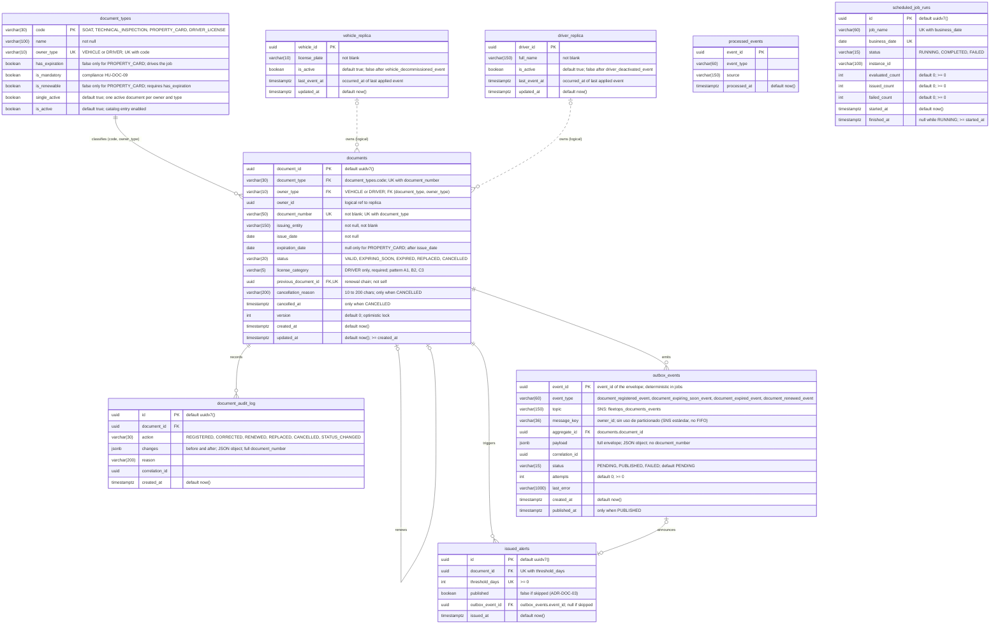

# **DAS – Servicio de Documentación y Seguros (FleetOps)**

*Equipo Documentación y Seguros · Versión 0.3 · Octubre 2026*

**Registro de cambios**

| Versión | Fecha | Cambio |
| :---- | :---- | :---- |
| 0.1 | Octubre 2026 | Versión inicial |
| 0.2 | 26-10-2026 | (1) El modelo de datos de las secciones 6 y 7 prevalece sobre el MER; el MER se alinea con los cuatro tipos, sin campos de póliza. (2) La licencia guarda una sola categoría (license\_category); se corrige ADR-DOC-07. (3) La fecha de negocio se calcula en America/Bogota (nuevo ADR-DOC-13; cierra el punto abierto 4). (4) Otros cambios incorporados en esta versión: broker por definir entre Kafka y AWS SNS + SQS (ADR-DOC-12, punto abierto 16); regla única de cálculo del estado (6.2); réplicas con is\_active y consumo de bajas (punto 12); PostgreSQL 18 con el schema document y detalle físico del modelo (14.1 a 14.4) |
| 0.3 | 26-10-2026 | Decisión del equipo FleetOps: el broker es **AWS SNS + SQS** (ADR-DOC-12, resuelto; cierra el punto abierto 16). Se agrega ADR-DOC-14 con la nomenclatura (tópicos, colas y tipos de evento en snake\_case e inglés, Message Attribute `event_type`) y se reescribe la sección 8. `document_registered_event` pasa a publicarse siempre que un documento se registra con éxito (antes ninguna HU lo contemplaba). Se confirma que una corrección (PATCH) puede dejar un documento EXPIRED (publica `document_expired_event`) o reactivarlo (publica `document_renewed_event` con `origin: CORRECTION`; cierra el punto abierto 11). Se confirma que anular un documento no publica ningún evento y el bloqueo permanece (riesgo abierto, sección 11) |

## **1\. Introducción y alcance**

**Propósito.** Este documento describe la arquitectura inicial del servicio de Documentación y Seguros: qué datos y reglas posee, cómo expone su API, qué eventos publica y consume y qué decisiones se tomaron. Sirve para alinear al equipo y para acordar los contratos con Vehículos, Conductores, Notificaciones y Reportes.

**Responsabilidad principal.** Controlar la vigencia de SOAT, revisión tecnomecánica y licencia de conducción, verificar que cada vehículo tenga su tarjeta de propiedad (que no vence) y emitir las alertas de vencimiento *antes* de que el documento venza.

**Documentos que gestiona.** Cada vehículo tiene tres documentos, todos obligatorios: SOAT, revisión tecnomecánica y tarjeta de propiedad, que no tiene vencimiento. Cada conductor tiene un único documento: su licencia de conducción, con una sola categoría (license\_category), fecha de inicio y fecha de expiración.

El backlog cubre las historias HU-DOC-01 a HU-DOC-11. La tabla separa lo que resuelve este servicio de lo que resuelven otros.

| Tema | Responsable |
| :---- | :---- |
| Vigencia y estado de SOAT, tecnomecánica y licencia; existencia de la tarjeta de propiedad | **Documentación y Seguros** |
| Cuándo y qué alerta de vencimiento emitir (job diario) | **Documentación y Seguros** |
| Consultas de gestión: próximos a vencer y cumplimiento documental | **Documentación y Seguros** |
| Categoría de la licencia de conducción: se guarda una sola categoría por licencia (ADR-DOC-07) | **Documentación y Seguros** |
| Bloquear un vehículo con documento vencido | Vehículos (reacciona a eventos) |
| Inhabilitar un conductor con licencia vencida | Conductores (reacciona a eventos) |
| Decidir a quién y por qué canal avisar | Notificaciones |
| Reportes de documentación por vencer | Reportes |
| Archivo digital del documento (PDF o imagen) | Sin definir (ver sección 12\) |

## **2\. Contexto y problema de negocio**

Hoy los documentos legales se controlan a mano sobre archivos físicos y suelen revisarse cuando ya vencieron. El resultado son sanciones económicas, vehículos operando sin cobertura vigente y conductores con licencia vencida sin que nadie lo advierta a tiempo. Este servicio existe para volver preventivo ese control.

La pregunta de negocio que le corresponde responder es: *¿qué vehículos tienen documentación próxima a vencer?*

| Stakeholder | Qué necesita de este servicio |
| :---- | :---- |
| Administrador de flota | Registrar, corregir, anular y renovar documentos; saber si un vehículo o conductor puede operar (HU-DOC-01 a 05 y 09\) |
| Gerente de operaciones | Ver qué documentación vence pronto para planificar renovaciones (HU-DOC-08) |
| Equipos de Vehículos y Conductores | Recibir document\_expired\_event y document\_renewed\_event para bloquear y desbloquear |
| Equipo de Notificaciones | Recibir document\_expiring\_soon\_event y document\_expired\_event |
| Equipo de Reportes | Recibir todos los eventos del servicio para construir su base de lectura |
| DevOps | Operar el servicio de forma aislada: salud, logs y contenedor (HU-DOC-11) |

## **3\. Posición del servicio dentro de FleetOps**

Documentación es productor de un solo tópico SNS y consumidor de dos. No llama por HTTP a Vehículos ni a Conductores: conoce a los propietarios mediante réplicas locales alimentadas por eventos.

| Dirección | Servicio | Qué intercambian |
| :---- | :---- | :---- |
| Consume | Vehículos (tópico SNS fleetops\_vehicles\_events, SUPUESTO: nombre por confirmar con ese equipo) | vehicle\_created\_event y vehicle\_decommissioned\_event: qué vehículos son propietarios válidos |
| Consume | Conductores (tópico SNS fleetops\_drivers\_events, SUPUESTO: nombre por confirmar con ese equipo) | driver\_created\_event y driver\_deactivated\_event: qué conductores son propietarios válidos |
| Publica | Vehículos | document\_expired\_event y document\_renewed\_event de un vehículo: agrega o quita el bloqueo DOCUMENTO |
| Publica | Conductores | document\_expired\_event y document\_renewed\_event de un conductor: agrega o quita el bloqueo DOCUMENTO |
| Publica | Notificaciones | document\_expiring\_soon\_event y document\_expired\_event: dispara los avisos |
| Publica | Reportes | Todos los eventos del tópico fleetops\_documents\_events |

## **4\. Requisitos arquitectónicamente significativos**

### **4.1 Del backlog a la arquitectura** 

| HU | De qué trata | Exigencia arquitectónica |
| :---- | :---- | :---- |
| HU-DOC-01 | Registrar los documentos de un vehículo (SOAT, tecnomecánica y tarjeta de propiedad) con sus fechas de vigencia | Validar el vehículo contra la réplica local; unicidad de tipo \+ número y un solo documento activo por vehículo y tipo; calcular el estado al registrar y publicar EXPIRED si nace vencido; la tarjeta de propiedad se registra sin fecha de vencimiento |
| HU-DOC-02 | Registrar la licencia de conducción de cada conductor con su vigencia | Registrar la licencia como único documento del conductor, con un solo documento activo por conductor; guardar una única categoría por licencia (license\_category, obligatoria) |
| HU-DOC-03 | Consultar un documento por su id y listar los de un vehículo o conductor con filtros | Consultas paginadas con filtros; estado y días restantes calculados con la fecha actual; los documentos sin vencimiento se ordenan al final |
| HU-DOC-04 | Corregir los datos de un documento o anularlo si se registró por error | Corrección con recálculo de estado y reinicio de alertas; anulación lógica con motivo |
| HU-DOC-05 | Renovar un documento (por ejemplo, un SOAT nuevo) conservando el anterior como historial | Renovación atómica: documento nuevo, anterior en REPLACED y evento en el outbox, segura ante concurrencia; no aplica a la tarjeta de propiedad |
| HU-DOC-06 | Avisar antes de que un documento venza. Cada día el sistema revisa solo los documentos y, cuando a uno le faltan 30, 15, 7 o 1 días, genera la alerta para que se renueve a tiempo y se eviten sanciones | Un job: un proceso programado que corre solo todos los días, sin que nadie lo active, y publica document\_expiring\_soon\_event al alcanzar cada umbral. Solo evalúa documentos con vencimiento (SOAT, tecnomecánica y licencia). Debe poder repetirse o correr en varias instancias sin generar avisos duplicados, recuperarse si el servicio estuvo caído y leer los umbrales de la configuración |
| HU-DOC-07 | Marcar como vencido lo que ya venció. Cuando la vigencia de un documento termina, el sistema lo pasa a EXPIRED e informa a Vehículos y Conductores para que no operen un vehículo ni un conductor sin documentación vigente | Lo hace el mismo job de HU-DOC-06: cambia a EXPIRED los documentos cuya fecha ya pasó y publica document\_expired\_event una sola vez; con ese evento Vehículos bloquea el vehículo y Conductores actualiza el estado del conductor. Las consultas también calculan el estado con la fecha actual, para no depender de que el job ya haya corrido |
| HU-DOC-08 | Consultar qué vehículos y conductores tienen documentación próxima a vencer en un horizonte de días | Consulta por horizonte de días enriquecida con las réplicas locales; la tarjeta de propiedad no aparece porque no vence |
| HU-DOC-09 | Consultar si un vehículo o conductor cumple con toda su documentación obligatoria | Consulta de cumplimiento sin efectos secundarios: tres documentos obligatorios por vehículo (SOAT, tecnomecánica y tarjeta de propiedad) y la licencia por conductor |
| HU-DOC-10 | Mantener copias locales de vehículos y conductores, alimentadas por eventos | Consumidor de eventos idempotente que mantiene réplicas mínimas, para validar propietarios sin llamar por HTTP a otros servicios |
| HU-DOC-11 | Poder operar y diagnosticar el servicio sin depender de otros equipos | Salud, logs JSON, contenedor, pipeline CI/CD y documentación OpenAPI |

### Las exigencias de HU-DOC-01, 02, 03, 05, 06, 08 y 09 incorporan las decisiones sobre tipos de documento.

### **4.2 Atributos de calidad principales**

| Característica | Atributo | Cómo se manifiesta en el servicio | Meta medible (fuente) |
| :---- | :---- | :---- | :---- |
| Funcionalidad | Correctitud | El estado de cada documento y sus días restantes son exactos según la fecha actual. | Estado calculado con la fecha actual en toda consulta (HU-DOC-07); 0 eventos nuevos en una segunda ejecución del job y EXPIRED publicado una sola vez (HU-DOC-06 y 07); con vencimiento el 20 de octubre, EXPIRING\_SOON ese día y EXPIRED desde el 21 (HU-DOC-07) |
| Seguridad | Integridad | Los datos legales no se alteran ni se pierden, ni siquiera con operaciones simultáneas | Renovación atómica, todo o nada, y solo una de dos renovaciones simultáneas tiene éxito (HU-DOC-05); tipo y propietario inmodificables; anulación sin borrado físico (HU-DOC-04) |
| Fiabilidad | Tolerancia a fallos | Ningún evento se pierde ni se duplica, el job se recupera de una caída y un documento con error no detiene a los demás | Outbox para publicar tras confirmar la transacción (HU-DOC-05); verificación pendiente al arrancar (HU-DOC-06 y 07); hasta 3 reintentos y luego cola de errores en el consumidor (HU-DOC-10) |
| Fiabilidad | Disponibilidad | El servicio sigue atendiendo si falla el broker y responde de forma controlada si cae la base de datos | /health en menos de 500 ms con la base de datos arriba; 503 en menos de 2 s si cae (HU-DOC-11); endpoints operativos sin broker, con reintento periódico de conexión (HU-DOC-10) |
| Performance | Comportamiento temporal | Las alertas salen con anticipación y el job termina en tiempo acotado | Alertas por defecto a 30, 15, 7 y 1 días, verificación diaria a las 06:00 UTC y menos de 5 minutos con 10.000 documentos (HU-DOC-06) |
| Compatibilidad | Interoperabilidad | Se integra con Vehículos, Conductores, Notificaciones y Reportes solo mediante contratos explícitos | Eventos con el sobre estándar sobre AWS SNS + SQS, filtrables por el Message Attribute event\_type, y esquemas en fleetops-contracts; API documentada en OpenAPI (HU-DOC-11); X-Correlation-Id en toda respuesta |
| Usabilidad | Protección contra errores de usuario | La API impide registros erróneos y repeticiones accidentales | 422 con mensaje y detalle por campo; 400 ante JSON mal formado; 409 ante duplicados; un doble clic o reintento no crea duplicados (HU-DOC-05); anulación con motivo de un registro erróneo (HU-DOC-04) |
| Seguridad | Confidencialidad | Los datos personales de las licencias no se exponen en logs ni en eventos | document\_number enmascarado en los logs, dejando los últimos 4 caracteres; los eventos no incluyen document\_number; la auditoría interna (document\_audit\_log) lo guarda completo; sin contraseñas ni tokens en logs (HU-DOC-11) |
| Seguridad | Responsabilidad | Cada cambio sobre un documento es rastreable | Historial de renovaciones con previous\_document\_id, motivo de anulación de 10 a 200 caracteres (HU-DOC-04 y 05\) y correlation\_id en los logs (HU-DOC-11); identificar a la persona depende de la autenticación, aún por definir |
| Mantenibilidad | Modularidad | Servicio autónomo con base de datos propia y sin llamadas HTTP a otros servicios | Réplicas locales alimentadas por eventos (HU-DOC-10); arranque aislado con docker compose up (HU-DOC-11) |
| Mantenibilidad | Capacidad de ser modificado | Las reglas de alerta y la configuración cambian sin tocar el código ni romper a los consumidores | Umbrales en ALERT\_THRESHOLD\_DAYS (HU-DOC-06); configuración por variables de entorno (HU-DOC-11); contratos versionados y revisados por los equipos consumidores |

No se incluyen autenticidad ni no repudio, que dependen de definir la autenticación del sistema

## **5\. Restricciones**

* Es un microservicio independiente con **base de datos propia**; ningún otro servicio accede a ella.  
* Decisión de negocio: cada vehículo tiene **tres documentos** (SOAT, tecnomecánica y tarjeta de propiedad) y cada conductor **una única licencia**; la tarjeta de propiedad no tiene vencimiento.  
* Comunicación asíncrona mediante **AWS SNS + SQS** (ADR-DOC-12, decidido por el equipo FleetOps el 26-10-2026). Publica en el tópico SNS **fleetops\_documents\_events** y consume, mediante colas SQS propias, los tópicos SNS de Vehículos y Conductores (sección 8). Los nombres de tópicos, colas y tipos de evento usan snake\_case en inglés (ADR-DOC-14).  
* Los eventos usan el sobre estándar del catálogo y se publican con el patrón Outbox.  
* API REST con JSON, documentada en OpenAPI dentro del repositorio fleetops-contracts, junto con los esquemas de los eventos.  
* La base de datos debe ofrecer transacciones y restricciones únicas, porque varias reglas del backlog dependen de ellas (renovación, alertas sin duplicados, un documento activo por tipo).  
* Configuración solo por variables de entorno; nada sensible en el repositorio.  
* Contexto colombiano: SOAT, revisión tecnomecánica, tarjeta de propiedad y licencia de conducción; la zona horaria de referencia es America/Bogota y con ella se calcula la fecha de negocio («hoy») en todo el servicio (ADR-DOC-13).  
* El SAD general todavía no define el lenguaje, el framework ni el motor de base de datos. Este servicio adopta Java 21, Spring Boot 4.1.1 y **PostgreSQL 18 o superior**, con el schema **document** (sección 14), en línea con el diagrama de arquetipo (sección 15). Falta ratificarlo en el SAD general.

## **6\. Modelo de dominio y datos**

### **6.1 Documento y tipos**

El documento es la única entidad de negocio del servicio. Campos principales: document\_id (UUID), document\_type, owner\_type, owner\_id, document\_number, issuing\_entity, issue\_date (fecha de inicio de vigencia), expiration\_date (vacía en la tarjeta de propiedad), status, days\_remaining (calculado y vacío si el documento no vence), license\_category (solo en DRIVER\_LICENSE: una única categoría por licencia), previous\_document\_id (en renovaciones), cancellation\_reason y cancelled\_at (motivo y fecha de anulación), version (control de concurrencia optimista) y las marcas created\_at y updated\_at.

Los valores de document\_type son SOAT, TECHNICAL\_INSPECTION, PROPERTY\_CARD y DRIVER\_LICENSE; los de owner\_type, VEHICLE y DRIVER. Se usan los mismos valores en la API, la base de datos y los eventos.

| Tipo (document\_type) | Documento | Propietario (owner\_type) | ¿Vence? | ¿Obligatorio para operar? (HU-DOC-09) | ¿Se renueva? | ¿Lo evalúa el job? |
| :---- | :---- | :---- | :---- | :---- | :---- | :---- |
| SOAT | SOAT | VEHICLE | Sí | Sí | Sí | Sí |
| TECHNICAL\_INSPECTION | Revisión tecnomecánica | VEHICLE | Sí | Sí | Sí | Sí |
| PROPERTY\_CARD | Tarjeta de propiedad | VEHICLE | No | Sí | No | No |
| DRIVER\_LICENSE | Licencia de conducción | DRIVER | Sí (fecha de inicio y de expiración) | Sí | Sí | Sí |

Cada propietario tiene como máximo un documento activo de cada tipo: un vehículo, hasta tres; un conductor, uno. Los documentos REPLACED y CANCELLED solo quedan como historial.

### **6.2 Estados**

| Estado | Significado | Cómo se llega |
| :---- | :---- | :---- |
| VALID | Vigente; en los documentos con vencimiento, days\_remaining mayor que el umbral mayor (30 por defecto). La tarjeta de propiedad permanece aquí mientras exista | Cálculo por fecha: registro, renovación o corrección con vencimiento lejano; registro de la tarjeta |
| EXPIRING\_SOON | Aún no vence y days\_remaining está entre 0 y el umbral mayor, ambos incluidos (solo documentos con vencimiento) | Cálculo por fecha, en cualquier momento: registro, renovación, corrección, consulta o job. No depende de que se haya emitido una alerta |
| EXPIRED | expiration\_date anterior a la fecha actual (days\_remaining negativo) | Cálculo por fecha: registro de un documento ya vencido, consulta o job diario (HU-DOC-07) |
| REPLACED | Sustituido por una renovación; queda como historial | Renovación (HU-DOC-05) |
| CANCELLED | Registrado por error; no se borra | Anulación (HU-DOC-04) |

**Regla única de cálculo (ADR-DOC-01).** VALID, EXPIRING\_SOON y EXPIRED se derivan solo de la fecha: days\_remaining = expiration\_date − fecha actual en America/Bogota. Si days\_remaining < 0, el estado es EXPIRED; si está entre 0 y el umbral mayor de ALERT\_THRESHOLD\_DAYS, EXPIRING\_SOON; si es mayor, VALID. Los documentos sin vencimiento quedan siempre en VALID. Esta misma regla se usa al registrar, al consultar y en el job. El job no decide el estado: persiste el estado calculado, publica document\_expiring\_soon\_event cuando days\_remaining coincide con un umbral sin emitir (issued\_alerts) y publica document\_expired\_event una sola vez.

El día del vencimiento el documento está EXPIRING\_SOON con days\_remaining 0 y pasa a EXPIRED desde el día siguiente. La tarjeta de propiedad no vence: solo pasa por VALID y CANCELLED, no entra al job y no se renueva (su reemplazo por traspaso o duplicado está por definir). REPLACED y CANCELLED son estados finales: no se modifican ni se anulan. Se considera activo un documento en VALID, EXPIRING\_SOON o EXPIRED, y desde esos estados se puede renovar (salvo la tarjeta) o anular.

### **6.3 Reglas de negocio clave**

* La combinación tipo \+ document\_number es única.  
* Un propietario tiene como máximo un documento activo por tipo: un vehículo, un SOAT, una tecnomecánica y una tarjeta de propiedad; un conductor, una licencia. Para cambiar de documento se usa la renovación.  
* expiration\_date es obligatoria para SOAT, tecnomecánica y licencia, y debe ser posterior a issue\_date; en la tarjeta de propiedad va vacía.  
* license\_category es obligatoria en DRIVER\_LICENSE (una sola categoría por licencia) y va vacía en los documentos de vehículo.  
* El propietario debe existir en la réplica local y estar activo (is\_active = true); si no, se responde 422.  
* La fecha actual de todas las reglas es la fecha de negocio en America/Bogota (ADR-DOC-13).  
* document\_type, owner\_type y owner\_id no se pueden modificar.  
* En una renovación, la nueva expiration\_date debe ser posterior a la del documento anterior y futura. No aplica a la tarjeta de propiedad.  
* Un vehículo cumple (HU-DOC-09) si tiene SOAT y tecnomecánica VALID o EXPIRING\_SOON y una tarjeta de propiedad VALID; un conductor cumple si su licencia está VALID o EXPIRING\_SOON.

### **6.4 Datos propios del servicio**

Todas las tablas viven en el schema **document** de PostgreSQL. El detalle de columnas, relaciones, restricciones e índices está en la sección 14 y en `database/document_schema.sql`.

| Tabla | Propósito | HU |
| :---- | :---- | :---- |
| document\_types | Catálogo de los cuatro tipos y sus reglas (propietario, si vence, si es obligatorio, si se renueva) | 01, 02 |
| documents | Documentos con su historial de renovaciones (previous\_document\_id) y la categoría de la licencia | 01 a 05 |
| document\_audit\_log | Registro de cada cambio sobre un documento (acción, antes y después, motivo, correlation\_id), con document\_number completo; es de uso interno y nunca se expone en logs ni en eventos | 01 a 05 |
| issued\_alerts | Umbrales ya emitidos por documento; restricción única (document\_id, threshold\_days) | 06 |
| scheduled\_job\_runs | Ejecuciones del job por fecha de negocio (estado, instancia y resumen: evaluados, emitidos, fallidos); permite la recuperación al arrancar y el monitoreo | 06, 07 |
| outbox\_events | Eventos pendientes de publicar, guardados en la misma transacción que el cambio | 05 y demás |
| processed\_events | event\_id de los eventos consumidos, para descartar repetidos | 10 |
| vehicle\_replica | vehicle\_id, license\_plate e is\_active (false tras la baja del vehículo) | 10 |
| driver\_replica | driver\_id, full\_name e is\_active (false tras la baja del conductor) | 10 |

## **7\. Interfaz síncrona (REST)**

| Método y ruta | Qué hace | HU | Respuestas principales |
| :---- | :---- | :---- | :---- |
| POST /documents | Registra SOAT, tecnomecánica, tarjeta de propiedad o licencia | 01, 02 | 201 con Location; 400; 409; 422 |
| GET /documents/{id} | Consulta un documento | 03 | 200; 400; 404 |
| GET /documents | Lista con filtros y paginación | 03 | 200 (vacío si no hay resultados); 400 |
| PATCH /documents/{id} | Corrige datos del documento | 04 | 200; 404; 409; 422 |
| POST /documents/{id}/cancellation | Anula con motivo | 04 | 200; 404; 409; 422 |
| POST /documents/{id}/renewals | Renueva conservando el anterior (no aplica a la tarjeta de propiedad) | 05 | 201 con Location; 400; 404; 409; 422 |
| GET /documents/expiring-soon?days={num} | Documentos próximos a vencer en un horizonte de días | 08 | 200; 400 |
| GET //documents/compliance?owner\_type=…\&owner\_id={uuid} | Cumplimiento documental de un vehículo o conductor | 09 | 200; 400; 404 |
| GET /health | Estado del servicio | 11 | 200 (UP); 503 (DOWN) |

**Convenciones del backlog.** 400 para solicitudes mal formadas o parámetros inválidos, 404 para recursos inexistentes, 409 para conflictos de unicidad o de estado y 422 para validaciones de negocio. Los mensajes van en español y el detalle por campo en detalles. Las fechas usan YYYY-MM-DD, las marcas de tiempo ISO 8601 en UTC, y la paginación usa page (desde 0\) y size (20 por defecto, máximo 100). Toda respuesta incluye X-Correlation-Id.

## **8\. Interfaz asíncrona (AWS SNS + SQS)**

> **Broker decidido (ADR-DOC-12, v0.3): AWS SNS + SQS.** Cada microservicio de FleetOps publica en su propio tópico SNS, con el nombre **fleetops\_{slug}\_events** en snake\_case e inglés (ADR-DOC-14); el de este servicio es **fleetops\_documents\_events**. Cada evento lleva un Message Attribute **event\_type** (String) con el tipo de evento en snake\_case terminado en `_event` (por ejemplo `document_registered_event`), que cada suscriptor usa en su FilterPolicy de SQS para recibir solo lo que le interesa. Las suscripciones usan raw message delivery: el consumidor recibe el sobre de dominio directamente como cuerpo del mensaje, sin el sobre de SNS. Las colas SQS que escuchan fleetops\_documents\_events son responsabilidad de cada equipo suscriptor; este documento solo nombra las propias (sección 8.2).

### **8.1 Eventos que publica**

Los eventos de los jobs usan un event\_id determinista para que dos instancias no generen duplicados distintos. La publicación sale del outbox hacia fleetops\_documents\_events, después de confirmar la transacción (ADR-DOC-05). Es un tópico SNS estándar (no FIFO): no hay orden garantizado entre tipos de evento distintos de un mismo documento: ver el riesgo correspondiente en la sección 11.

| Evento (Message Attribute event\_type) | Cuándo se publica | HU | Quién escucha |
| :---- | :---- | :---- | :---- |
| document\_registered\_event | Se registra un documento nuevo (POST /documents) con éxito, sin importar su estado inicial; incluida la tarjeta de propiedad, que no vence | 01, 02 | Reportes; para la tarjeta de propiedad es la única señal de que existe |
| document\_expiring\_soon\_event | El job detecta que un SOAT, una tecnomecánica o una licencia alcanzó un umbral (30, 15, 7 y 1 días según el catálogo) | 06 | Notificaciones, Reportes |
| document\_expired\_event | El job marca como vencido un SOAT, una tecnomecánica o una licencia; se registra uno ya vencido; o una corrección (PATCH) deja vencido un documento que no lo estaba | 01, 02, 04, 07 | Vehículos o Conductores (bloqueo), Notificaciones, Reportes |
| document\_renewed\_event | Se registra la renovación de un SOAT, una tecnomecánica o una licencia; o una corrección (PATCH) devuelve a VALID o EXPIRING\_SOON un documento EXPIRED (origin CORRECTION) | 04, 05 | Vehículos o Conductores (levantan el bloqueo), Reportes |

`document_registered_event` se publica siempre que el registro tiene éxito; si además el documento nace vencido, también se publica `document_expired_event` para el mismo documento (son dos hechos distintos y pueden coexistir).

**Pendiente (riesgo, sección 11).** Anular un documento (POST /documents/{id}/cancellation) no publica ningún evento: si el documento estaba EXPIRED, Vehículos o Conductores mantienen el bloqueo. El equipo confirmó el 26-10-2026 que el comportamiento queda así por ahora.

### **8.2 Eventos que consume**

Documentación consume, mediante colas SQS propias, los tópicos SNS de Vehículos y Conductores. Los nombres de esos tópicos son responsabilidad de cada equipo; se asume que siguen la misma convención (ADR-DOC-14) — **SUPUESTO, por confirmar con los equipos de Vehículos y Conductores**.

| Tópico SNS (origen) | Cola SQS propia (y su DLQ) | Evento (Message Attribute) | Acción |
| :---- | :---- | :---- | :---- |
| fleetops\_vehicles\_events | fleetops\_documents\_vehicle\_events\_queue (fleetops\_documents\_vehicle\_events\_dlq) | vehicle\_created\_event | Guarda vehicle\_id y license\_plate en vehicle\_replica con is\_active = true |
| fleetops\_vehicles\_events | fleetops\_documents\_vehicle\_events\_queue | vehicle\_decommissioned\_event | Marca el vehículo con is\_active = false: deja de ser propietario válido y no acepta documentos nuevos; sus documentos se conservan (catálogo; HU-DOC-10 aún no lo cubre) |
| fleetops\_drivers\_events | fleetops\_documents\_driver\_events\_queue (fleetops\_documents\_driver\_events\_dlq) | driver\_created\_event | Guarda driver\_id y full\_name en driver\_replica con is\_active = true |
| fleetops\_drivers\_events | fleetops\_documents\_driver\_events\_queue | driver\_deactivated\_event | Marca el conductor con is\_active = false: deja de ser propietario válido y no acepta documentos nuevos; sus documentos se conservan (catálogo; HU-DOC-10 aún no lo cubre) |

Reglas del consumidor: cada cola tiene su propio FilterPolicy de SNS→SQS para recibir solo esos dos tipos de evento; el mensaje se borra (Delete) solo tras procesar con éxito (si no, vuelve a ser visible al expirar el visibility timeout); idempotencia por event\_id guardado en la misma transacción que la réplica (processed\_events); descarte de eventos más antiguos que el ya aplicado (se compara el occurred\_at del evento con last\_event\_at de la réplica; no se usa record\_version); tolerancia a atributos desconocidos; redrive policy con maxReceiveCount = 3 hacia la DLQ correspondiente. Nunca se descarta un mensaje en silencio.

### **8.3 Flujos clave**

**Vencimiento de un documento**

1. El job diario marca el documento como EXPIRED y guarda document\_expired\_event en el outbox.  
2. El publicador lo envía al tópico SNS fleetops\_documents\_events.  
3. Vehículos (o Conductores) agrega el bloqueo DOCUMENT y publica el cambio de estado; Notificaciones avisa; Reportes actualiza su base de lectura.

**Renovación**

1. El administrador llama a POST/documents/{id}/renewals.  
2. En una sola transacción se crea el documento nuevo, el anterior pasa a REPLACED y se guarda document\_renewed\_event en el outbox.  
3. Vehículos (o Conductores) quita el bloqueo causado por el documento anterior y, si no quedan otros bloqueos, el vehículo vuelve a AVAILABLE.

**Alta de un vehículo y su primer documento**

1. Vehículos publica vehicle\_created\_event y Documentación actualiza su réplica.  
2. Solo a partir de ese momento POST /documents acepta documentos de ese vehículo.

## **9\. Componentes y decisiones**

### **9.1 Componentes internos**

| Componente | Responsabilidad | HU |
| :---- | :---- | :---- |
| API REST | Validación, códigos de error, cabecera Location y OpenAPI | 01 a 05, 08, 09 |
| Lógica de dominio | Estado según la fecha, unicidad, renovación y cumplimiento | 01 a 09 |
| Job de vigencia | Ejecución diaria, recuperación al arrancar y manejo de umbrales | 06, 07 |
| Publicador de outbox | Lee outbox\_events y publica en el tópico SNS fleetops\_documents\_events tras el commit | 05 y demás |
| Consumidor de réplicas | Consumidores SQS idempotentes (fleetops\_documents\_vehicle\_events\_queue, fleetops\_documents\_driver\_events\_queue) que mantienen las réplicas | 10 |
| Persistencia | Base de datos propia con restricciones únicas | Todas |
| Salud y observabilidad | /health, logs JSON y correlación | 11 |

### **9.2 Decisiones del servicio**

| \# | Decisión | Por qué | Consecuencia / costo |
| :---- | :---- | :---- | :---- |
| ADR-DOC-01 | VALID, EXPIRING\_SOON y EXPIRED se calculan solo por fecha y días restantes (America/Bogota), sin depender de la evaluación del job. El estado se guarda (al registrar, corregir, renovar y en el job) y además se recalcula con la fecha actual en cada consulta | El estado mostrado es correcto aunque el job no haya corrido (HU-DOC-07) | La regla de cálculo es una sola (sección 6.2), compartida por el registro, las consultas y el job; los filtros por estado se calculan sobre expiration\_date y no sobre la columna guardada |
| ADR-DOC-02 | Job diario a las 06:00 UTC (01:00 en Bogotá), con recuperación al arrancar y tabla issued\_alerts con restricción única | Impide duplicados con varias instancias o reejecuciones (HU-DOC-06) | La garantía vive en la base de datos, no en memoria |
| ADR-DOC-03 | Si un documento cumple varios umbrales sin emitir, se publica un solo evento con el umbral menor y los mayores se marcan como emitidos | Evita una avalancha de avisos tras una caída | Se pierden los avisos intermedios |
| ADR-DOC-04 | La renovación crea un documento nuevo enlazado con previous\_document\_id y deja el anterior en REPLACED, en una transacción | Historial completo y operación de todo o nada | Exige control de concurrencia: restricción única más bloqueo o versión |
| ADR-DOC-05 | Patrón Outbox: el evento se guarda junto con el cambio y otro proceso lo publica en SNS (fleetops\_documents\_events) | El estado nunca cambia sin que se publique el evento, ni viceversa | Un proceso adicional y una pequeña latencia |
| ADR-DOC-06 | Réplicas locales mínimas (id y placa o nombre), sin HTTP a Vehículos ni Conductores | Evita el ciclo entre servicios y permite operar si otros caen | Desfase breve: un propietario recién creado puede rechazarse con 422 |
| ADR-DOC-07 | Cada licencia guarda una sola categoría (license\_category), obligatoria en DRIVER\_LICENSE | La licencia es el único documento del conductor y su categoría forma parte de los datos del documento; guardarla evita consultar a Conductores por HTTP | Si un conductor tiene varias categorías, se registra solo la más específica según las políticas de la empresa; un cambio de categoría se registra como corrección (PATCH) o renovación |
| ADR-DOC-08 | Anulación lógica con motivo; nunca borrado físico | Trazabilidad completa | Las consultas excluyen CANCELLED salvo que se filtre por ese estado |
| ADR-DOC-09 | Umbrales en alert\_threshold\_days, validados al arrancar | Cambiar las alertas sin tocar código; una configuración inválida impide arrancar | Un cambio de umbrales exige reiniciar el servicio |
| ADR-DOC-10 | Las reglas por tipo (propietario permitido, si vence, si es obligatorio y si se renueva) viven en document\_type | La tarjeta de propiedad no vence: el job, las alertas y las consultas se rigen por el tipo y no por condicionales dispersos | La matriz de tipos debe mantenerse alineada con el catálogo de eventos |
| ADR-DOC-11 | Un solo documento activo por propietario y tipo, garantizado por una restricción única parcial en la base de datos (estados VALID, EXPIRING\_SOON y EXPIRED) | Refleja la decisión de negocio (tres documentos por vehículo, una licencia por conductor) y evita duplicados incluso con peticiones simultáneas | La renovación debe pasar el anterior a REPLACED antes de insertar el nuevo, en la misma transacción |
| ADR-DOC-12 | El broker de mensajería es **AWS SNS + SQS** (decidido por el equipo FleetOps, 26-10-2026; resuelve el punto abierto 16). Cada microservicio publica en su propio tópico SNS; cada interesado se suscribe con su propia cola SQS. El núcleo sigue publicando y consumiendo solo a través de puertos de salida y de entrada (hexagonal) | Servicio gestionado y serverless (sin clúster propio); SNS→SQS con fan-out permite que cada equipo tenga su cola y su DLQ independientes, sin que Documentación conozca a sus consumidores | Tópicos SNS estándar, no FIFO: sin orden garantizado entre tipos de evento de un mismo documento (ver riesgo, sección 11); límite de 256 KB por mensaje; cambiar de broker en el futuro exige cambiar solo el adaptador de salida (y de entrada) de mensajería |
| ADR-DOC-13 | La fecha de negocio («hoy») se calcula en America/Bogota mediante un reloj propio del servicio, con la zona configurable por variable de entorno. El job sigue programado a las 06:00 UTC (01:00 en Bogotá) | Con UTC, desde las 7 p. m. en Bogotá ya sería el día siguiente y un documento aparecería vencido horas antes (punto abierto 4) | Una sola fuente de fecha para el job y las consultas; las pruebas fijan el reloj para cubrir los casos de borde. Las marcas de tiempo (created\_at, occurred\_at) siguen en UTC |
| ADR-DOC-14 | Nomenclatura y enrutamiento de mensajería: tópicos `fleetops_{slug}_events`; colas propias con el patrón `fleetops_{consumidor}_{origen}_events_queue` y su DLQ `..._dlq`; cada evento lleva un Message Attribute `event_type` (String) en snake\_case terminado en `_event` (p. ej. `document_registered_event`); el body es el sobre de dominio completo; raw message delivery habilitada en las suscripciones SQS | Nombres uniformes y legibles entre los microservicios de FleetOps (inglés y snake\_case); el Message Attribute permite que cada suscriptor filtre por tipo de evento con su FilterPolicy sin descargar ni parsear el body; raw delivery evita que el consumidor tenga que desenvolver el sobre de SNS para llegar al sobre de dominio | Todo tipo de evento nuevo debe anunciarse con su valor de event\_type antes de publicarse, para que los equipos consumidores ajusten su FilterPolicy; los nombres de tópicos de otros servicios (Vehículos, Conductores) deben confirmarse con cada equipo (sección 8.2) |

## **10\. Aspectos transversales**

* **Seguridad y privacidad:** Los logs no incluyen contraseñas ni tokens. La autenticación y los roles se heredan del SAD general y aún no están definidos para este servicio.  
* **Observabilidad:** logs JSON por salida estándar con marca de tiempo, nivel, correlation\_id y mensaje; el job termina con un resumen (evaluados, emitidos, fallidos); /health y las métricas de lag y de mensajes en la cola de errores del catálogo.  
* **Resiliencia:** con la base de datos caída, los endpoints responden 503 en menos de 2 segundos; con AWS SNS/SQS caído o inalcanzable, los endpoints siguen respondiendo y los eventos esperan en el outbox; un error en un documento no detiene la verificación de los demás.  
* **Configuración:** credenciales, umbrales y conexión a AWS (región, tópico SNS, colas SQS) llegan por variables de entorno.  
* **Entrega:** Dockerfile; arranque con docker compose up , con su propia base de datos y esquema creado automáticamente; el pipeline compila y prueba en cada pull request y publica la imagen al integrar a main.  
* **Pruebas:** unitarias para estados y fechas (por ejemplo, vencimiento el 20 de octubre: EXPIRING\_SOON ese día y EXPIRED desde el 21); de integración para renovaciones concurrentes, doble ejecución del job y tarjeta de propiedad sin vencimiento (fuera del job); de contrato para eventos y OpenAPI.

## **11\. Riesgos iniciales**

| Riesgo | Impacto | Mitigación |
| :---- | :---- | :---- |
| «Fecha actual» calculada en la zona horaria equivocada | Vencimientos y alertas con un día de error | Fecha de negocio en America/Bogota (ADR-DOC-13) y pruebas de los casos de borde |
| Eventos duplicados o perdidos | Vehículo bloqueado sin motivo o sin bloquear cuando debía | Outbox, event\_id determinista en los jobs y consumidores idempotentes |
| Dos renovaciones simultáneas | Dos documentos vigentes del mismo tipo | Restricción única parcial en base de datos |
| document\_renewed\_event sin el id del documento anterior | Vehículos no puede levantar el bloqueo correcto | Punto 1 de la sección 12 |
| Documento obligatorio ausente: un vehículo sin SOAT, tecnomecánica o tarjeta de propiedad registrados no genera ningún evento | Vehículo que opera sin bloqueo | Punto 6 de la sección 12 |
| Anular (CANCELLED) un documento EXPIRED no publica ningún evento | Vehículos o Conductores mantienen el bloqueo aunque el documento se haya anulado | Confirmado por el equipo (26-10-2026) que queda así por ahora; pendiente para un ciclo posterior (ver observación O-08 de docs/G01\_Endpoints\_Documentacion.xlsx) |
| Mensajes fuera de orden (SNS estándar, no FIFO) | Un document\_renewed\_event podría procesarse antes que un document\_expired\_event anterior del mismo documento | Consumidores idempotentes y basados en estado (ya exigido por el diseño: processed\_events, issued\_alerts); evaluar SNS/SQS FIFO si el orden resulta crítico |
| Réplicas incompletas o desactualizadas | 422 injustificados, placas viejas o propietarios dados de baja aún válidos | Consumir baja y actualización; mensaje claro y reintento del cliente |
| Carga inicial de la flota existente | Ráfaga de document\_expired\_event y de avisos | Planificar la carga con Notificaciones y Reportes; evaluar una carga masiva |
| Job lento o caído | Alertas tardías | Meta de 5 minutos con 10.000 documentos, recuperación al arrancar y monitoreo de cada ejecución |
| Datos personales en las licencias | Exposición indebida | Enmascarar en logs, no incluirlos en los eventos y guardarlos completos solo en la auditoría interna |

## **12\. Inconsistencias y puntos abiertos**

El backlog actual difiere del SAD general y del catálogo de topics en varios puntos. Los marcados como **Alta** deben cerrarse antes de construir.

| \# | Tema | Backlog actual | SAD general y catálogo | Propuesta |
| :---- | :---- | :---- | :---- | :---- |
| 1 | **Alta** · Contenido de document\_renewed\_event | Incluye previous\_document\_id | El catálogo trae solo las fechas de vencimiento anterior y nueva | Si Vehículos guarda el bloqueo con el id del documento causante, al renovar ese id cambia y necesita el anterior para quitarlo: agregar previous\_document\_id al catálogo |
| 4 | **Resuelto (v0.2, ADR-DOC-13)** · Zona horaria de «fecha actual» | HU-DOC-07 usa el 20 y el 21 de octubre y el job corre a las 06:00 UTC | Contexto colombiano | Definir la fecha en America/Bogota: con UTC, a las 7 p. m. de Bogotá ya sería el día siguiente y el documento aparecería vencido horas antes de tiempo |
| 6 | **Alta** · Documento obligatorio ausente | HU-DOC-09 informa los faltantes al consultar, pero nada avisa cuando a un vehículo le falta el SOAT, la tecnomecánica o la tarjeta de propiedad, ni a un conductor su licencia; el bloqueo solo nace con document\_expired\_event | Vehículos bloquea al recibir document\_expired\_event; el catálogo no cubre documentos ausentes. Desde v0.3, document\_registered\_event sí se publica siempre (sección 8.1), pero un documento que nunca se registra sigue sin generar ninguna señal | Asignaciones consulte el cumplimiento (HU-DOC-09) por HTTP antes de asignar. De esta forma, Asignaciones  NO decide con su réplica |
| 7 | **Alta** · Tipos de documento | Las HU ya fueron actualizadas con los documentos definidos: SOAT, tecnomecánica y tarjeta de propiedad por vehículo, y una licencia por conductor | El catálogo y el SAD general aún no reflejan estos cuatro tipos de documento | **Resuelto en este DAS** (secciones 6.1 y 14): SOAT, TECHNICAL\_INSPECTION, PROPERTY\_CARD y DRIVER\_LICENSE, con owner\_type VEHICLE o DRIVER. Queda pendiente alinear el catálogo y el SAD general y hacer opcional expiration\_date en los eventos, porque la tarjeta de propiedad no vence |
| 8 | Media · Un documento activo por tipo | HU-DOC-01 y 02 solo rechazan otro documento VALID o EXPIRING\_SOON; con uno EXPIRED se podría crear un segundo documento del mismo tipo sin pasar por la renovación | Decisión: como máximo un documento de cada tipo por propietario | Responder 409 si ya existe un documento activo (VALID, EXPIRING\_SOON o EXPIRED) y exigir la renovación; garantizarlo con una restricción única parcial |
| 9 | Media · Tarjeta de propiedad: reemplazo | No contempla una tarjeta nueva (traspaso o duplicado); la renovación (HU-DOC-05) exige una nueva fecha de vencimiento | La tarjeta no vence | Responder 422 si se intenta renovar la tarjeta, corregir errores con PATCH y definir si un traspaso o duplicado deja la tarjeta anterior en REPLACED o se corrige sobre el mismo documento |
| 11 | **Resuelto (v0.3, 26-10-2026)** · PATCH y renovación | Cambiar expiration\_date de un vencido publica document\_renewed\_event sin documento nuevo (HU-DOC-04) | La renovación crea un documento nuevo (HU-DOC-05) | El equipo confirmó que el PATCH sí puede reactivar un documento vencido. Publica document\_renewed\_event con origin CORRECTION, sobre el mismo documento (no crea uno nuevo); ver docs/G01\_Endpoints\_Documentacion.xlsx, observación O-07 |
| 12 | Media · Réplicas | Solo consume created; HU-DOC-08 muestra placa y nombre desde la réplica; el orden se decide con occurred\_at | También dado\_de\_baja; los topics de estado traen record\_version | **Resuelto en este DAS** (secciones 6.4 y 8.2): se consumen vehicle\_decommissioned\_event y driver\_deactivated\_event, que marcan is\_active = false en la réplica; no se usa record\_version y el orden se decide con occurred\_at frente a last\_event\_at. El consumo de actualizaciones (por ejemplo, cambio de placa) sigue pendiente |
| 14 | Media · Archivo digital | No se contempla adjuntar el documento escaneado | El contexto describe archivos físicos como origen del problema | Decidir si el servicio guarda el archivo, solo su referencia o nada |
| 15 | Media · Roles y carga inicial | Ninguna HU define quién registra, anula o consulta, ni cómo cargar la flota existente | Seguridad por definir en el SAD general | Definir roles y evaluar una carga masiva inicial |
| 16 | **Resuelto (v0.3, ADR-DOC-12 y ADR-DOC-14)** · Broker de mensajería | Las HU y el catálogo v1.0 asumen Kafka | AWS SNS + SQS, con tópicos y colas en snake\_case (fleetops\_documents\_events; patrón fleetops\_{slug}\_events) | El equipo FleetOps decidió AWS SNS + SQS el 26-10-2026. Falta: provisionar los tópicos y colas (o LocalStack en desarrollo), implementar el publicador SNS y los consumidores SQS, y confirmar con Vehículos y Conductores los nombres de sus propios tópicos |

## **13\. Próximos pasos**

1. Definir los esquemas de eventos y el OpenAPI del servicio.  
2. Elaborar el ERD del servicio y el diagrama de componentes.  
3. Orden sugerido de construcción: HU-DOC-11 (esqueleto operable), HU-DOC-10 (sin réplicas no se puede registrar nada), HU-DOC-01 y 02, HU-DOC-03, HU-DOC-06 y 07 juntas (comparten el job), HU-DOC-05, HU-DOC-04, y por último HU-DOC-08 y 09\.

## **14\. Diagrama MER \- Modelo Datos**

Motor: **PostgreSQL 18 o superior**, en el schema **document**. El script de creación es `database/document_schema.sql` e incluye tablas, relaciones, restricciones, índices y el catálogo document\_types. Usa uuidv7(), que existe desde PostgreSQL 18. Mientras no se adopten migraciones, ese script es la referencia del esquema; el diagrama y las tablas de esta sección deben mantenerse alineados con él.

### **14.1 Relaciones**

| Relación | Tipo | Regla |
| :---- | :---- | :---- |
| documents → document\_types | FK compuesta fk\_documents\_document\_type (document\_type, owner\_type) → (code, owner\_type) | El tipo existe y el propietario corresponde al tipo: un SOAT no puede pertenecer a un DRIVER |
| documents → documents | FK fk\_documents\_previous\_document + UNIQUE uk\_documents\_previous\_document | Cadena de renovaciones; un documento se renueva como máximo una vez (ADR-DOC-04) |
| issued\_alerts → documents | FK fk\_issued\_alerts\_document | Alertas emitidas por documento (HU-DOC-06) |
| issued\_alerts → outbox\_events | FK fk\_issued\_alerts\_outbox\_event (opcional) | Evento que anunció el umbral; vacío si el umbral se omitió (ADR-DOC-03) |
| document\_audit\_log → documents | FK fk\_document\_audit\_log\_document | Trazabilidad de cada cambio (DAS sec. 4.2) |
| outbox\_events → documents | FK fk\_outbox\_events\_document (aggregate\_id) | Todo evento corresponde a un documento existente (ADR-DOC-05) |
| documents → vehicle\_replica / driver\_replica | Lógica, sin FK (owner\_type + owner\_id) | El propietario se valida en la aplicación contra la réplica activa (ADR-DOC-06) |

### **14.2 Restricciones**

| Tabla | Restricción | Regla | Origen |
| :---- | :---- | :---- | :---- |
| document\_types | ck\_document\_types\_owner\_type | owner\_type en VEHICLE o DRIVER | 6.1 |
| document\_types | ck\_document\_types\_renewable\_requires\_expiration | Un tipo sin vencimiento no se renueva | 6.2 |
| documents | uk\_documents\_type\_number | document\_type + document\_number únicos | 6.3 |
| documents | uk\_documents\_one\_active\_per\_owner\_type (índice único parcial) | (owner\_type, owner\_id, document\_type) únicos cuando status está en VALID, EXPIRING\_SOON o EXPIRED | ADR-DOC-11 |
| documents | ck\_documents\_status | status en VALID, EXPIRING\_SOON, EXPIRED, REPLACED o CANCELLED | 6.2 |
| documents | ck\_documents\_expiration\_after\_issue | expiration\_date posterior a issue\_date | 6.3 |
| documents | ck\_documents\_license\_category | Obligatoria si owner\_type es DRIVER (formato A1, B2, C3…); vacía en vehículos | ADR-DOC-07 |
| documents | ck\_documents\_cancellation | CANCELLED exige cancelled\_at y un motivo de 10 a 200 caracteres; los demás estados los dejan vacíos | ADR-DOC-08 |
| documents | ck\_documents\_not\_self\_renewal | previous\_document\_id distinto de document\_id | ADR-DOC-04 |
| documents | ck\_documents\_document\_number\_not\_blank, ck\_documents\_issuing\_entity\_not\_blank | Sin valores en blanco | 6.1 |
| documents | ck\_documents\_version, ck\_documents\_timestamps | version ≥ 0; updated\_at ≥ created\_at | ADR-DOC-04 |
| documents | trg\_documents\_check\_type\_rules (trigger) | Lee document\_types: expiration\_date obligatoria si el tipo vence y vacía si no; no se renueva un tipo con is\_renewable en false; no se registran documentos de tipos inactivos. En una renovación: mismo tipo y propietario que el anterior, el anterior ya en REPLACED y expiration\_date posterior a la suya | ADR-DOC-10, ADR-DOC-04, ADR-DOC-11 |
| documents | trg\_documents\_guard\_update (trigger) | document\_type, owner\_type, owner\_id y previous\_document\_id inmodificables; un documento REPLACED o CANCELLED no se modifica | 6.2, 6.3 |
| documents | trg\_documents\_prevent\_delete (trigger) | Prohíbe el borrado físico | ADR-DOC-08 |
| issued\_alerts | uk\_issued\_alerts\_document\_threshold | (document\_id, threshold\_days) únicos | ADR-DOC-02 |
| issued\_alerts | ck\_issued\_alerts\_published\_event | published es true solo si hay outbox\_event\_id | ADR-DOC-03 |
| document\_audit\_log | ck\_document\_audit\_log\_action, ck\_document\_audit\_log\_changes\_object | Acción del catálogo de acciones; changes es un objeto JSON | 4.2 |
| outbox\_events | ck\_outbox\_events\_event\_type | Solo los cuatro eventos de la sección 8.1 | 8.1 |
| outbox\_events | ck\_outbox\_events\_status, ck\_outbox\_events\_published | Estados PENDING, PUBLISHED o FAILED; published\_at solo en PUBLISHED | ADR-DOC-05 |
| scheduled\_job\_runs | uk\_scheduled\_job\_runs\_job\_date | Una ejecución por job y fecha de negocio | ADR-DOC-02 |
| scheduled\_job\_runs | ck\_scheduled\_job\_runs\_finished | finished\_at vacío mientras está RUNNING; al terminar, posterior a started\_at | 6.4 |

### **14.3 Índices**

| Índice | Columnas | Uso |
| :---- | :---- | :---- |
| uk\_documents\_one\_active\_per\_owner\_type | documents (owner\_type, owner\_id, document\_type), parcial en estados activos | Restricción de ADR-DOC-11 |
| ix\_documents\_owner | documents (owner\_type, owner\_id) | Listado por propietario y cumplimiento (HU-DOC-03 y 09) |
| ix\_documents\_active\_expiration | documents (expiration\_date), parcial en documentos activos con vencimiento | Job de vigencia y próximos a vencer (HU-DOC-06, 07 y 08) |
| ix\_document\_audit\_log\_document | document\_audit\_log (document\_id, created\_at) | Historial de cambios de un documento |
| ix\_outbox\_events\_pending | outbox\_events (created\_at), parcial en PENDING | Lectura del publicador del outbox |
| ix\_outbox\_events\_aggregate | outbox\_events (aggregate\_id) | Eventos de un documento |

### **14.4 Catálogo document\_types**

| code | name | owner\_type | has\_expiration | is\_mandatory | is\_renewable | single\_active | is\_active |
| :---- | :---- | :---- | :---- | :---- | :---- | :---- | :---- |
| SOAT | SOAT | VEHICLE | true | true | true | true | true |
| TECHNICAL\_INSPECTION | Revisión tecnomecánica | VEHICLE | true | true | true | true | true |
| PROPERTY\_CARD | Tarjeta de propiedad | VEHICLE | false | true | false | true | true |
| DRIVER\_LICENSE | Licencia de conducción | DRIVER | true | true | true | true | true |

**Supuestos del modelo físico** (el DAS no los fija; deben confirmarse): las longitudes de los textos; issuing\_entity obligatoria; el formato de license\_category (letra y dígito opcional); el catálogo de acciones de auditoría.

## **15\. Diagrama Arquetipo**

> **Nota v0.3.** El broker ya está decidido: AWS SNS + SQS (ADR-DOC-12, ADR-DOC-14; sección 8). Los adaptadores «Listener Kafka» y «Outbox Kafka» del diagrama representan, respectivamente, el consumidor SQS y el publicador SNS; el nombre de la imagen quedó desactualizado (heredado de una referencia inicial a Kafka) y debe regenerarse en una próxima iteración. Mientras tanto, estos nombres son solo ilustrativos.

